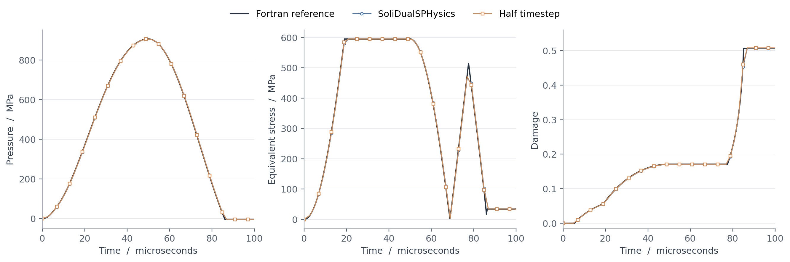

# HJC compression, shear and unloading

This 20 mm cube is a **fully prescribed 3-D patch test** of the HJC material
and finite-deformation interface. It is not a wave-propagation or fracture
localization benchmark. The input uses SI units and a demonstration concrete
parameter set, not a calibrated material card.

With `h(t) = sin(pi*t/100 microseconds)^2`, the prescribed deformation is

```text
F = [1-.015h    .04h       0    ]
    [   0     1-.015h    .02h  ]
    [   0        0     1-.015h ]
```

Pressure, shear plasticity and irreversible crushing develop during loading;
the second half unloads and reverses shear. All particle velocities are
prescribed analytically. The spacing is 2.5 mm and the solid timestep is
0.1 microseconds. Repeat with half the timestep and smaller spacing when
assessing a new parameter set or loading path.



The reference uses the previously R13-checked Fortran material update with
independent polar/log-strain kinematics and a 5 ns timestep. It is a material
point reference, not a new LS-DYNA run. The plot retains the solver's saved
times. Peak-normalized pressure/stress RMSE was 0.342%/0.806% at 100 ns,
and 0.171%/0.409% at 50 ns. These errors include the host's staggered time
integration. CPU examples and the standalone tests were run; the CUDA
solver was compiled with CUDA 12.8, but GPU execution was not tested.

## Run

From this directory, with the solver and DSPartVTK built:

```sh
mkdir -p out
../../bin/linux/GenCase_linux64 HJC_Def out/HJC -save:all
../../bin/linux/SoliDualSPHysicsCPU_linux64 out/HJC out -dirdataout bindata -svres
../../DSPartVTK/bin/DSPartVTK_linux64 -dirin out/bindata -filexml out/HJC.xml -savecsv out/csv/hjc -savevtk out/vtk/hjc
```

For a combined CUDA build, replace the CPU executable by
`SoliDualSPHysics_linux64 -cpu`, or use `-gpu` on a supported NVIDIA device.
The extra CSV/VTK fields are `Time`, `HJCPressure` (compression positive),
`HJCDamage`, `HJCPlasticStrain`, `HJCPlasticVolume` and `HJCInternalWork`.
The last field is accumulated stress work per reference volume, **not stored
elastic energy**. For HJC, the legacy `Strain_Energy` output contains this
internal work multiplied by particle reference volume. Use the actual saved
times: the solver can cross the requested output/final time in its outer step.

## Material convention

Select `constitmodel=4` and provide the 19 `hjc` attributes shown in the XML.
`G, FC, T, PC, PL, K1, K2, K3` have stress units; `EPS0` is inverse time;
the remaining parameters are dimensionless. Density is specified separately.
The initial bulk modulus is `PC/UC`. Young's modulus and Poisson's ratio
are derived from it and `G`; do not supply independent elastic constants.

The update follows an **R13-compatible HJC convention**, tested against
MAT_111 output. In particular:

- `mu = 1/J - 1`; the previous density measure selects the crushing/locking
  branch and unloading modulus. Full compaction uses the cubic EOS in
  `(mu-UL)/(1+UL)`. Arbitrary parameter choices need not join these branches
  continuously.
- The tensile pressure cutoff uses the previous damage. The tensile strength
  branch is `A*(1-D-p/T)` for `p<0`.
- The logarithmic rate factor retains rates below `EPS0` (floor `1e-8` in
  the chosen time units). A negative strength is bounded at zero; `SFMAX`
  caps the final normalized strength.
- `EFMIN` gates damage evolution: accumulate damage only when
  `D1*(p/FC+T/FC)^D2 > EFMIN`. It is not a denominator floor here.
- If that gate is open at initialization, damage starts at
  `min(1,1e-4/[D1*(T/FC)^D2])`; accumulated plastic strain still starts at zero.
  At exactly zero strength the R13-compatible plastic-strain counter freezes.

These choices are explicit implementation conventions, not a claim that all
HJC implementations or solver releases use them. Stress is updated in the
incrementally rotated frame using logarithmic strain and converted to
`P = J*sigma*inverse(F)^T`. The current EOS acoustic modulus updates the
solid CFL estimate. HJC damage is independent of the phase-field variable;
phase-field fracture must be disabled. Fully damaged concrete retains its
pressure-dependent compressive strength. Particle erosion (`FS`), thermal
effects and restart are outside this material addition; the solver already
rejects deformable-solid restart.

## Regression tests

```sh
cmake -S ../../tests/hjc -B /tmp/soli-hjc-tests
cmake --build /tmp/soli-hjc-tests
ctest --test-dir /tmp/soli-hjc-tests --output-on-failure
```

The tests cover analytic elastic invariants and all three shear components,
crushing/unloading, damage irreversibility, confined residual strength,
finite rotations and superposed rotations of a plastic 3-D path. Six small
reference transitions are numerical R13 solver-output fixtures, with starting
state and trial deviatoric stress reconstructed from output history. They
test the constitutive return, not a complete LS-DYNA simulation. No LS-DYNA
installation, SDK source or solver binary is needed to run the tests.

## References

1. Holmquist, T. J., Johnson, G. R., and Cook, W. H. (1993).
   *A computational constitutive model for concrete subjected to large strains,
   high strain rates, and high pressures*. Proceedings of the 14th
   International Symposium on Ballistics, Quebec, pp. 591-600.
2. Ansys/LST, *LS-DYNA Keyword User's Manual, Volume II, R13.0*,
   `*MAT_JOHNSON_HOLMQUIST_CONCRETE` (`*MAT_111`).
   [Official manual index](https://lsdyna.ansys.com/manuals-3/).
   The solver-specific conventions listed above are regression observations;
   the manual alone does not establish them.
